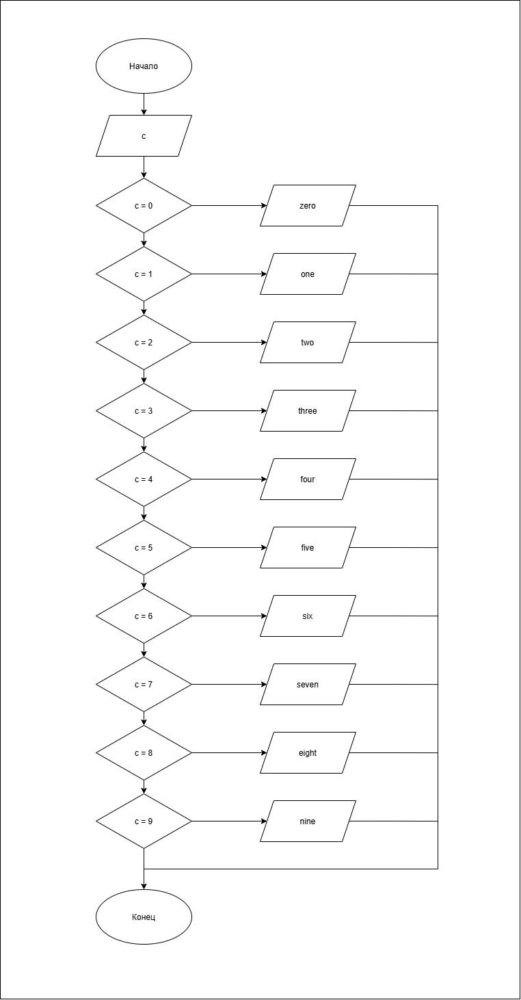

# Домашнее задание к работе 7
## Условие задачи
Составить программу, которая для каждой введенной цифры (0-9) вывести соответствующее ей название на английском языке (0 – zero, 1 – one, 2 – two...).

## 1. Алгоритм и блок-схема

### Алгоритм
1. **Начало**
2. Ввести цифру:
   - `c` — цифра.
3. Вывести название цифры на английском языке.
4. **Конец**

### Блок-схема


## 2. Реализация программы

```C
#include <stdio.h>
#include <locale.h>

int main()
{
    setlocale(LC_CTYPE, "RUS.UTF-8");

    char c;

    puts("Введите цифру:");
    scanf("%c", &c);

    switch (c)
    {
        case '0':
            printf("%c - zero", c);
            break;
        case '1':
            printf("%c - one", c);
            break;
        case '2':
            printf("%c - two", c);
            break;
        case '3':
            printf("%c - three", c);
            break;
        case '4':
            printf("%c - four", c);
            break;
        case '5':
            printf("%c - five", c);
            break;
        case '6':
            printf("%c - six", c);
            break;
        case '7':
            printf("%c - seven", c);
            break;
        case '8':
            printf("%c - eight", c);
            break;
        case '9':
            printf("%c - nine", c);
            break;
    }

    return 0;
}
```
## 3. Результаты работы программы

0 -> zero
1 -> one
2 -> two
3 -> three
4 -> four
5 -> five
6 -> six
7 -> seven
8 -> eight
9 -> nine

## 4. Информация о разработчике

бТИИ-261 Иголкин Максим Александрович
